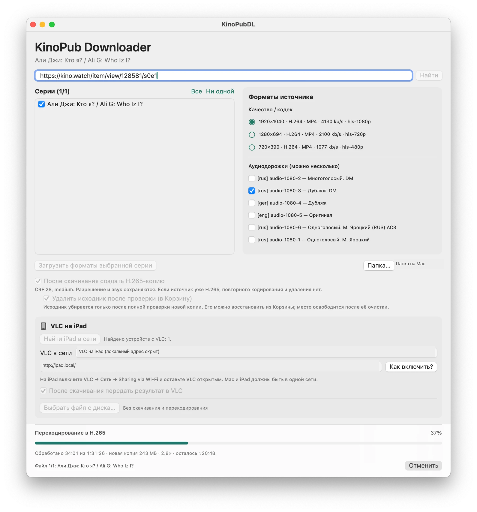

# KinoPubDL

**KinoPubDL — нативное приложение macOS для скачивания фильмов и сериалов с Kino.Pub / kino.watch при наличии авторизации и доступа к видео в вашем аккаунте.** Оно использует yt-dlp с плагином [yt-dlp-kinopub](https://github.com/niazlv/yt-dlp-kinopub), позволяет выбрать качество, озвучку и серии, а также передать готовые файлы в VLC на iPad.

> Приложение не предоставляет подписку, аккаунт или доступ к закрытому контенту. Сначала войдите в Kino.Pub в своём браузере. Скачивание работает только для видео, доступных вашей сессии; может потребоваться активная подписка. Используйте приложение для материалов, которые вы вправе скачивать.

## Скриншот



На скриншоте показана предоставленная пользователем предыдущая версия интерфейса во время перекодирования. В новой версии добавлены пополняемая очередь и выбор браузера для авторизации. Локальные адреса и путь пользователя на изображении скрыты.

## Скачать сборку из GitHub Actions

Workflow [Build KinoPubDL](https://github.com/nordz0r/KinoPubDL/actions/workflows/ci.yml) собирает приложение на **macos-15 (Apple Silicon / arm64)** и **macos-15-intel (Intel / x86_64)**.

1. Откройте вкладку **Actions → Build KinoPubDL** и выберите успешно завершённый запуск нужного коммита.
2. В разделе **Artifacts** скачайте `KinoPubDL-macos-arm64` для M1/M2/M3/M4 и других Apple Silicon или `KinoPubDL-macos-x86_64` для Intel. Для загрузки артефактов GitHub может потребоваться вход в аккаунт.
3. Внутри артефакта находятся ZIP с `KinoPubDL.app` и файл SHA-256. Распакуйте архив приложения и перенесите `.app` в `~/Applications` или `/Applications`.
4. Установите внешние инструменты по инструкции ниже. Они не встроены в ZIP, cookies и аккаунты туда также не входят.

CI запускается для pull request, изменений в `main`, тегов `v*` и вручную через **Run workflow** (после появления workflow в основной ветке). Артефакты хранятся 14 дней. CI не публикует GitHub Release автоматически и не выдаёт Apple Developer ID: приложение имеет **ad-hoc подпись, без notarization**. При блокировке доверенной сборки используйте штатное подтверждение в «Системные настройки → Конфиденциальность и безопасность → Всё равно открыть»; защиту macOS глобально отключать не нужно.

Проверка архива (находясь в папке с ZIP и `.sha256`):

```bash
shasum -a 256 -c KinoPubDL-macos-arm64.zip.sha256
```

Для Intel замените имя на `KinoPubDL-macos-x86_64.zip.sha256`.

## Запуск приложения

После установки приложение находится в `~/Applications/KinoPubDL.app` (или в выбранной вами папке).

- Через Spotlight: **⌘Пробел → KinoPubDL → Enter**.
- Через Finder: **Переход → Личная папка → Applications → KinoPubDL.app**, двойной щелчок.
- Для быстрого доступа после запуска: правая кнопка на иконке в Dock → **Параметры → Оставить в Dock**.

Terminal и запуск Swift для обычного использования не нужны. Если macOS запрещает чтение cookies Safari, предоставьте полный доступ к диску именно установленной копии `~/Applications/KinoPubDL.app` и перезапустите её. Для передачи уже готового файла с диска cookies Safari не требуются.

## Пополняемая очередь

Во время скачивания, H.265-кодирования или отправки в VLC можно вставлять новые ссылки, получать форматы и добавлять задачи кнопкой «Добавить в очередь». Поиск использует отдельный процесс и не меняет прогресс текущей задачи.

- У каждой добавленной серии сохраняются свои качество, аудиодорожки, папка, флаги H.265/удаления исходника и адрес VLC. Изменение настроек в окне касается только новых задач.
- В блоке «Очередь» видны текущая и ожидающие задачи. «Убрать» удаляет только ожидающую задачу; «Убрать ожидающие» очищает ожидание, не останавливая текущую.
- Файлы с диска тоже добавляются в эту очередь кнопкой «Добавить передачу в очередь» во время любой активной задачи.
- «Отменить текущую» отменяет только текущую задачу. Следующая ожидающая запускается автоматически, как и после ошибки предыдущей; ошибки записываются в журнал.
- Выполнение строго последовательное. Очередь хранится в памяти и теряется при закрытии приложения.

Проверка этого сценария без сети и Safari:

```bash
bash Tests/run_queue_tests.sh
```

## Передача файла с диска

Этот режим доступен сразу после запуска, без ссылки на KinoPub, yt-dlp, ffmpeg или cookies Safari.

1. Включите на iPad VLC → Сеть → Sharing via Wi‑Fi. Приложение само начнёт поиск устройства; при необходимости нажмите «Найти iPad в сети» или укажите адрес вручную.
2. В блоке «VLC на iPad» нажмите «Выбрать файл с диска…». Можно выбрать один или несколько файлов; они появятся в списке вместе с размерами.
3. Проверьте устройство и нажмите «Добавить передачу в очередь». Сам выбор в диалоге ещё ничего не отправляет.
4. Файлы копируются последовательно, без скачивания, перекодирования или удаления оригиналов. Кнопка «Отменить текущую» останавливает текущую передачу; ожидающие задачи продолжаются.

Если версия VLC не предоставляет распознаваемую форму загрузки, приложение откроет страницу для ручной передачи и не сообщит, что файл уже отправлен. Процент передачи внутри файла пока не измеряется: показываются имя, размер и номер файла с индикатором ожидания.

## Возможности

- Вставка ссылки на фильм, сезон или сериал.
- Список эпизодов по сезонам с выбором галками.
- Выбор исходного разрешения/кодека и одной или нескольких аудиодорожек.
- По умолчанию скачивается исходный поток без перекодирования; H.265 в списке качеств появляется только если его предоставляет источник. При раздельных HLS-потоках ffmpeg объединяет видео и звук. Для нескольких дорожек контейнер выбирается MKV.
- Отдельная галка «После скачивания создать H.265-копию» включает `libx265`, CRF 28, medium. Разрешение и аудиодорожки сохраняются; если источник уже HEVC, повторное кодирование пропускается.
- Под ней есть выключенная по умолчанию галка «Удалить исходник после проверки (в Корзину)». При её включении новая копия полностью проверяется декодированием, затем исходник перемещается в Корзину. При ошибке, отмене до завершения проверки, изменении исходного файла или пропуске перекодирования источник не удаляется. Чтобы фактически освободить место, Корзину нужно очистить вручную. Настройка не применяется к ранее скачанным файлам автоматически.
- Прогресс разделён на этапы: скачивание (байты, скорость и остаток в текущем потоке), объединение, H.265 (обработанное время, скорость, размер копии и оценка остатка), проверка и передача в VLC. Неизвестный общий размер показывается честно, без выдуманного процента.
- Очередь загружает эпизоды последовательно, показывает прогресс, позволяет остановить текущую задачу и не перезаписывает файлы.
- Необязательная передача в VLC на iPad через локальную страницу Wi‑Fi Sharing. Если страница не сообщает стандартную форму загрузки, приложение открывает её для ручного добавления файла.

## Требования

- macOS 13 или новее.
- Swift 6.0+ и Command Line Tools / Xcode нужны только для сборки из исходников. Для готового `.app` Swift устанавливать не нужно.
- Внешние `yt-dlp`, `ffmpeg` и `ffprobe` (поставляется с ffmpeg).
- Плагин `yt-dlp-kinopub`, установленный в окружение yt-dlp, либо репозиторий-плагин в `~/.config/yt-dlp/plugins/yt-dlp-kinopub` (передаётся через `--plugin-dirs`).
- Один из поддерживаемых браузеров с действующей авторизованной сессией Kino.Pub / kino.watch и доступом к выбранному видео.

Приложение ищет бинарники в `~/.local/bin`, `/opt/homebrew/bin` (Apple Silicon) и `/usr/local/bin` (Intel). Рекомендуемая установка через Homebrew и uv:

```bash
brew install uv ffmpeg
```

```bash
uv tool install yt-dlp --with yt-dlp-kinopub
```

Если yt-dlp уже установлен через uv:

```bash
uv tool upgrade yt-dlp
```

Это отдельные процессы: Swift-приложение не импортирует Python-пакеты. Сторонний плагин проверяйте перед установкой. Сам `.app` не включает yt-dlp, ffmpeg, браузеры или их cookies.

## Авторизация и cookies браузера

В блоке «Авторизация Kino.Pub» доступны **Safari, Google Chrome, Firefox, Microsoft Edge, Brave, Chromium, Opera и Vivaldi**. Приложение передаёт выбор в штатный параметр yt-dlp `--cookies-from-browser`.

1. Откройте Kino.Pub / kino.watch в выбранном браузере и войдите в свой аккаунт. Убедитесь, что нужное видео доступно и проигрывается.
2. Вставьте ссылку на фильм или серию в KinoPubDL и выберите тот же браузер.
3. Нажмите «Прочитать cookies и проверить вход». Кнопка читает cookies через yt-dlp и проверяет доступ по указанной ссылке, **не скачивая видео**. Просто чтение cookies ещё не означает, что подписка или доступ действуют — проверка обращается к сайту.
4. При успехе нажмите «Найти», выберите форматы и добавьте задачу в очередь.

Это не постоянный экспорт cookies: приложение не создаёт cookie-файлы и не просит логин или пароль. Cookies заново читаются yt-dlp из выбранного браузера при обращении к сайту. Секреты не входят в скриншот или документацию. Каждая задача очереди сохраняет выбор браузера; переключение браузера для новой ссылки не влияет на уже добавленные задачи.

Разрешения macOS:

- **Safari:** в «Системные настройки → Конфиденциальность и безопасность → Полный доступ к диску» предоставьте доступ установленному `KinoPubDL.app` и перезапустите его. При `Operation not permitted` проверьте это разрешение.
- **Chrome / Edge / Brave и другие Chromium-браузеры:** macOS может запросить доступ к Связке ключей для расшифровки cookies; без разрешения авторизация может не работать.
- **Firefox:** нужна активная сессия в обычном профиле. Выбор конкретного профиля или контейнера пока не реализован.

Наличие браузера в списке означает поддержку соответствующего параметра yt-dlp, а не гарантию работы с любой версией браузера. Если сессия истекла, заново войдите на сайт и повторите проверку. Передача локальных файлов в VLC не требует браузера или подписки.

## Сборка

```bash
git clone https://github.com/nordz0r/KinoPubDL.git
```

```bash
cd KinoPubDL
```

```bash
bash Tests/run_tests.sh
```

```bash
bash build_app.sh --install
```

Скрипт генерирует иконку из `Scripts/render_icon.swift`, создаёт `KinoPubDL.app` рядом с пакетом и при `--install` копирует приложение в `~/Applications`. Перед обновлением закройте приложение. Если в папке назначения находится другое приложение или символическая ссылка, установка прекращается без перезаписи.

Исходник логотипа: `Assets/Logo.svg`; PNG 1024×1024: `Assets/Logo.png`; готовая иконка macOS: `Assets/AppIcon.icns`.

## Использование

1. Откройте приложение, вставьте URL, выберите браузер, в котором авторизованы на сайте, при необходимости проверьте cookies и нажмите «Найти».
2. Отметьте нужные серии, нажмите «Загрузить форматы выбранной серии», выберите исходное качество/кодек и аудиодорожки.
3. Выберите папку. Для компактной копии включите «После скачивания создать H.265-копию», затем нажмите «Добавить в очередь». Сначала будет показан прогресс загрузки, затем перекодирования. Без этой галки пересжатия нет. Новая копия получает суффикс `.h265-crf28`; существующие копии не перезаписываются. Исходник сохраняется по умолчанию. Если отдельно включить «Удалить исходник после проверки (в Корзину)», он переместится в Корзину после полной проверки H.265-копии. После проверки выводятся размеры до и после. При включённой передаче в VLC отправляется итоговая копия, а не промежуточный файл.
   - Кнопка «Отменить текущую» останавливает текущую загрузку, перекодирование или передачу в VLC и не запускает следующий этап этой задачи; следующая задача очереди продолжается автоматически. Отмена до окончания проверки H.265 сохраняет исходник. Уже завершённое перемещение исходника в Корзину отмена дальнейшей передачи в VLC не обращает: его можно восстановить вручную. При отмене уже начатой отправки на iPad может остаться неполный файл.
   - Полоса закреплена внизу окна и остаётся видимой при прокрутке настроек. Она относится к текущему этапу текущего файла; при переходе от скачивания к кодированию процент начинается заново. После кодирования идёт отдельная проверка файла. Завершение каждой задачи отмечается в журнале; если в очереди есть следующая, прогресс переключается на неё.
   - Автоматические проверки: `bash Tests/run_tests.sh`. Проверка реального yt-dlp и ffmpeg на локальном 12-секундном тестовом видео: `bash Tests/run_tests.sh --pipeline-smoke`; сеть и Safari для неё не нужны. XCTest и полный Xcode не требуются.
4. Для iPad включите в VLC **Сеть → Sharing via Wi‑Fi** и оставьте VLC открытым. При включении галки передачи приложение автоматически ищет VLC через Bonjour и среди известных Mac соседей по ARP (не более 32 локальных адресов, порты 80 и 8080). Полная подсеть не сканируется. Приложение проверяет, что найденная страница принадлежит VLC, и подставляет адрес. Повторить поиск можно кнопкой «Найти iPad в сети». Если найдено несколько устройств, выберите нужное в списке. Ручной адрес остаётся запасным вариантом. Для поиска дайте приложению разрешение «Локальная сеть», если macOS запросит его.
5. Приложение считывает endpoint из формы или `data-url` поля загрузки на странице VLC; URL не зашит. Для страниц без поддерживаемой формы открывается браузер для ручного drag-and-drop. Фильм с отдельной HLS-аудиодорожкой и неизвестным кодеком (`acodec: null`) теперь распознаётся как аудио, а не теряется в списке.

> Передача по Wi‑Fi требует, чтобы Mac и iPad находились в одной локальной сети. Реальный upload зависит от того, какую форму предоставляет установленная версия VLC; не документированный URL не зашит в приложение.
